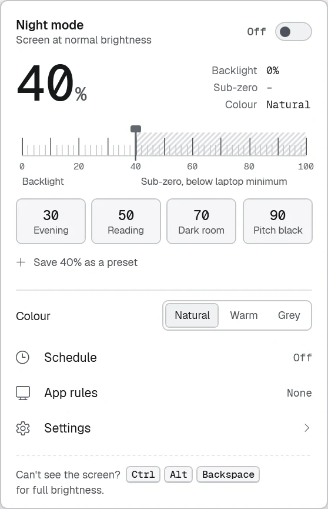
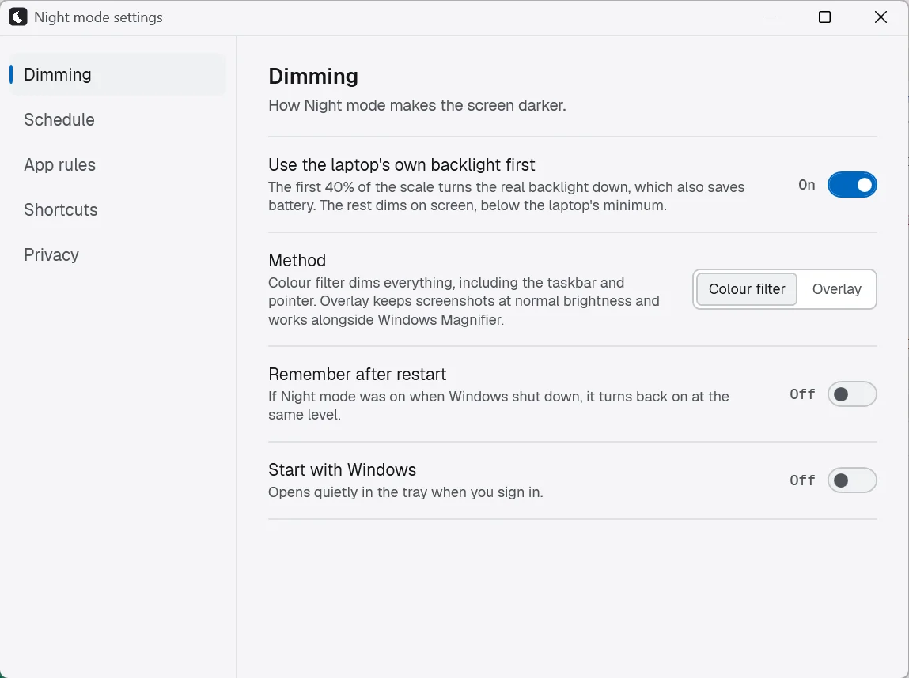

# Night mode for Windows

**Night mode makes your laptop screen darker than its own lowest brightness.** It's a free, open-source tray app for Windows 10 and 11, and it needs no account and shows no ads.

It first turns the real backlight down to the hardware minimum. Then it keeps dimming on screen, down to 4% of normal brightness. Windows' own brightness slider can't go that low.

Website: **[nightmode.bunkwise.in](https://nightmode.bunkwise.in)**. There is also an Android version: **[Night mode on Google Play](https://play.google.com/store/apps/details?id=com.bunkwise.nightmode)**.

<p>
  
  
</p>

## Download

**[NightMode-1.1.0-win-x64.zip](https://github.com/madhavraj840/bunkwise-night/releases/download/v1.1.0/NightMode-1.1.0-win-x64.zip)** (0.4 MB). It runs on any 64-bit Windows 10 or 11 PC with nothing else to install.

Night mode uses **.NET Framework 4.8**, which is already part of Windows 11 and Windows 10 (May 2019 Update or later). On an older Windows 10, install [.NET Framework 4.8](https://dotnet.microsoft.com/download/dotnet-framework/net48) first.

All versions are listed on the **[Releases page](https://github.com/madhavraj840/bunkwise-night/releases/latest)**.

SHA-256 checksum for v1.1.0:

```
0b865d87cbd3dac5ad828da213372b9a040e660e0cb6ed9f8aeaea0fe1a103fb  NightMode-1.1.0-win-x64.zip
```

## Install

1. **Download** the zip above.
2. **Unzip it:** right-click the zip, choose **Extract All…**, then **Extract**. You can move the folder anywhere you like, for example into Documents.
3. **Run** `NightMode.exe`. You may see **"Windows protected your PC"**. This happens because the app is new and not code-signed yet. Click **More info**, then **Run anyway**. Windows only asks once.
4. **Find it in the tray:** Night mode lives in the system tray next to the clock. If you don't see the moon icon, click the **^** arrow. Click the icon to open the panel.
5. **Optional:** open **Settings → Dimming → Start with Windows** so the app is ready every time you sign in.

To uninstall, quit the app from its tray menu and delete the folder. Your settings are stored in `%APPDATA%\NightMode`, which you can delete too.

## How it dims

| Scale | What happens |
|---|---|
| 0–40 | The laptop's real backlight goes down, from your current level to the hardware minimum. This also saves battery. |
| 40–100 | The **sub-zero** range: a full-screen colour filter dims the screen further, down to 4% of normal brightness. It's never fully black. |

- **No backlight control:** on a desktop or external monitor, the colour filter covers the whole scale instead.
- **Overlay method:** if the colour filter isn't available, or you pick **Overlay** in Settings, a click-through overlay is used instead.
- **Crashes:** if the app crashes, Windows removes the filter, and the next launch restores your backlight.

## Features

- Presets: Evening 30, Reading 50, Dark room 70, Pitch black 90, plus your own
- Colour: Natural, Warm (amber) or Grey
- Schedule, with a gradual ease-in
- App rules: dimming pauses while a chosen app is in front
- Full brightness for 30 seconds, 1 minute or 5 minutes, after which dimming comes back on its own
- Remember after restart and Start with Windows (both off by default)

## Shortcuts

| Keys | Action |
|---|---|
| `Ctrl + Alt + D` | Turn on or off |
| `Ctrl + Alt + −` / `+` | Darker / brighter |
| `Ctrl + Alt + S` | Screenshot at normal brightness |
| `Ctrl + Alt + Backspace` | **Full brightness (emergency)** |

`Ctrl + Alt + Backspace` works even when the screen is too dark to see.

## Privacy

Night mode works fully offline. It has no account, no ads and no analytics, and it doesn't make network connections. Your settings stay on your PC.

## Build from source

You need the [.NET SDK](https://dotnet.microsoft.com/download) and the [.NET Framework 4.8 Developer Pack](https://dotnet.microsoft.com/download/dotnet-framework/net48). The app has no NuGet packages.

```powershell
dotnet run --project checks   # dimming-maths checks
dotnet build NightMode.csproj -c Release -p:DebugType=none
# the app is bin\Release\net48\NightMode.exe
```

## Requirements

- Windows 10 or 11, 64-bit, with .NET Framework 4.8 (built into Windows 10 May 2019 Update and later)
- Backlight control needs a laptop or another panel that Windows can dim. On other screens, the colour filter does all the dimming.

## Licence

[MIT](LICENSE) © 2026 BunkWise Technologies. The bundled Geist fonts are under the [SIL Open Font License](Assets/Fonts/OFL.txt).

Night mode is a screen dimmer, not a medical device.
